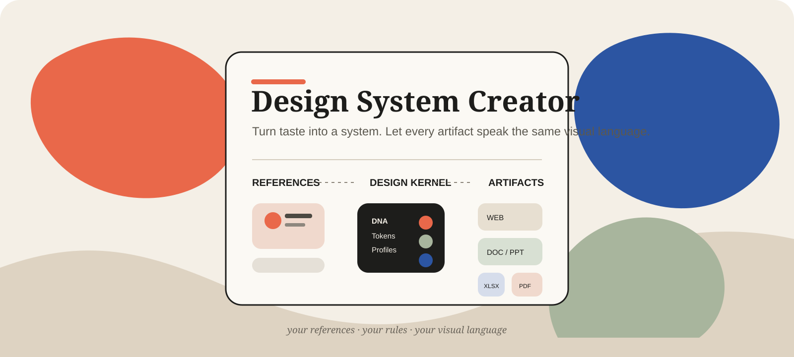
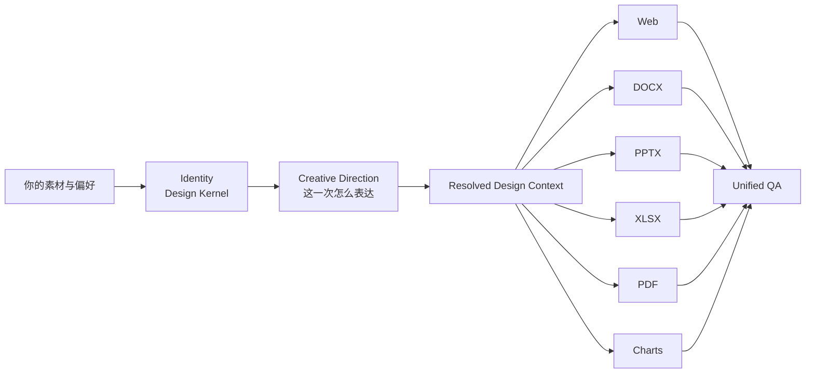

<p align="center">
  
</p>

<h1 align="center">Design System Creator</h1>

<p align="center">
  <strong>把“我喜欢这种感觉”，变成 AI 可以长期稳定执行的设计系统。</strong><br/>
  <sub>References → Design DNA → Design Kernel → Creative Direction → Web / DOCX / PPTX / XLSX / PDF / Charts</sub>
</p>

<p align="center">
  
  
  
  
</p>

<p align="center">
  <a href="#它到底做什么">它能做什么</a> ·
  <a href="#一分钟开始">一分钟开始</a> ·
  <a href="#完整工作流">完整工作流</a> ·
  <a href="#安装给-agent">安装给 Agent</a> ·
  <a href="#直接复制的提示词">直接复制的提示词</a>
</p>

---

## 它不是一套“好看的模板”

Design System Creator 不预设你应该喜欢什么颜色、什么字体、什么网页风格。

它做的是另一件事：**帮助 AI 认识你的审美，然后把这些偏好编译成一套可解释、可确认、可版本管理、可跨媒介执行的 Design System。**

你可以给它你喜欢的照片、建筑、网页、杂志、PPT、字体、品牌、插画，甚至只告诉它“这张我只喜欢配色，不喜欢排版”。它会把这些材料拆成证据，而不是凭感觉替你下结论。

最后得到的不是一个 Prompt，而是一套可以继续使用的 **Design Kernel**：

- 设计哲学与 Design Principles
- Anti-style / 明确不做什么
- Foundation / Semantic Tokens
- Typography / Color / Spacing / Imagery / Motion
- Core + Style Profiles
- Web / DOCX / PPTX / XLSX / PDF / Charts 的媒介规则
- Provenance、Confidence、Decision Log、Versioning
- 可独立安装的 Runtime Skill
- 默认不包含私人原图的 Portable Design System

> **Skill 不负责定义你的审美。Skill 负责执行你的审美。**

---

## 它到底做什么

| 01 · Discover | 02 · Build | 03 · Create |
|---|---|---|
| 从参考图片、文档和对话里发现稳定偏好，区分“观察到的事实”和“AI 的推断”。 | 把确认过的偏好编译成 Design Kernel、Tokens、Profiles、规则和 Runtime Skill。 | 用同一设计身份生成 Web、Word、PPT、Excel、PDF、图表，同时允许每次任务有自己的 Creative Direction。 |

| 04 · Refine | 05 · Audit | 06 · Export |
|---|---|---|
| 只改用户指定的区域，最小化改动范围，避免一次改稿把整个系统带偏。 | 分开检查 Identity、Creative、Medium、Technical 四类问题，而不是让 AI 给自己一个模糊“审美分”。 | 导出 Runtime Skill、Portable Design System、版本信息和 QA 证据。 |

---

## 一个入口，三层设计逻辑



**Identity** 回答“这是谁的东西”。  
**Creative Direction** 回答“这一次应该怎么表达”。  
**Renderer** 回答“在这个媒介里，具体怎么把它做出来”。

这三个层级被故意分开，所以同一个人的 PPT、网站和 Excel 可以拥有一致的视觉身份，却不会像把同一个网页模板硬套到所有文件上。

---

## 最重要的几个设计决定

### 多模态不是默认成立的

如果当前模型/宿主不能确认真的读到了图片像素，Skill **禁止描述图片内容**。

它把两件事分开：

- **Model Capability**：模型是否支持 Vision / Image Input；
- **Host Capability**：当前 App / Agent 是否能把附件、多图、文件夹或 ZIP 真正交给模型。

`VISION_UNKNOWN` 和 `VISION_UNSUPPORTED` 都不会进入图片审美分析。宁可明确 BLOCKED，也不靠文件名、路径、占位符或想象补图。

### 连续发图时，AI 不会抢跑

参考素材使用显式事务：

```text
COLLECTING
  ↓
继续上传，AI 只接收不分析
  ↓
“上传完成”
  ↓
VALIDATING
  ↓
“开始分析”
  ↓
ANALYZING
```

这对移动端尤其重要。你可以一张一张发；Skill 不会因为看到第 3 张、第 9 张或者你停了几秒，就自己判断“应该发完了”。

### AI 的判断不等于你的决定

核心设计事实分成三种状态：

```text
OBSERVED  → 从材料里直接观察到
INFERRED  → AI 根据证据做出的推断
CONFIRMED → 用户明确确认，可以进入长期 Kernel
```

高置信度的 `INFERRED` 仍然不是 `CONFIRMED`。

### 每张参考图可以有不同权重

你可以告诉它：

- `core` — 这张非常像我
- `positive` — 我喜欢
- `partial` — 只喜欢某些部分
- `negative` — 我明确不喜欢
- `neutral` — 只是参考资料

甚至可以表达：

```text
R07
喜欢：配色、摄影
不喜欢：排版、圆角
```

于是 Design DNA 不会把“喜欢这张图”粗暴理解成“喜欢图里的一切”。

---

## 一分钟开始

### 场景 A：建立自己的长期 Design System

直接说：

```text
我要建立自己的设计系统。我会连续发参考图。
在我说“上传完成”之前先只接收，不要分析。
上传完成后先核对素材；等我说“开始分析”再正式分析。
```

随后正常聊天即可。Skill 会在真正有不确定性的地方追问，而不是机械跑固定 20 道问卷。

### 场景 B：我现在只想做一份 PPT / Word / Excel / 网页

```text
用 Design System Creator 处理这份材料。
我现在不想做完整的长期审美建档，先为这个任务建立 Temporary Design Context，直接把作品做好。
```

### 场景 C：已经有 Design Kernel

```text
按我现有的 Design Kernel 做这份报告。
这一次希望更冷静、信息密度更高，但不要修改长期 Design Kernel；把变化放进 Temporary Art Direction。
```

### 场景 D：只修改局部

```text
只重做第 3 页的构图和图表。
文字内容、字体、其他页面和长期 Design Kernel 全部保持不变。
```

---

## 完整工作流

```text
Natural Request
      ↓
Intent Router
      ↓
Capability Gate + Source Gate
      ↓
Reference Intake / Existing Kernel
      ↓
Evidence Model
      ↓
Design DNA
      ↓
Design Kernel
      ↓
Content Semantics
      ↓
Creative Direction
      ↓
Temporary Art Direction (optional)
      ↓
Resolved Design Context
      ↓
Medium Renderer
      ↓
Identity + Creative + Medium + Technical QA
      ↓
Deliver / Refine / Export / Compile Runtime Skill
```

用户不需要先理解这些内部术语。正常说需求即可；Skill 自己路由到 `DISCOVER / BUILD / CREATE / REFINE / AUDIT / EXPORT`。

---

## Design Kernel 不是模板

长期 Design Kernel 保存的是“身份边界”，不是固定构图。

例如长期规则可能是：

```text
克制，但不冷漠
精密，但不炫技
允许高信息密度，但层级必须清楚
强调色可以强，但使用面积要克制
摄影保留真实质感
避免无意义的 AI SaaS 装饰
```

而某次任务可以临时变成：

```text
Profile: Editorial
Task: AI research report
Temporary Direction:
- cooler
- more technical
- less accent color
- higher information density
```

任务结束后 Temporary Direction 消失，长期审美不会被一次项目悄悄改掉。

---

## 跨媒介，不做“一个模板硬套六次”

| Medium | 优先关注 |
|---|---|
| **Web** | 叙事、响应式、交互、Motion、性能与真实浏览器 QA |
| **DOCX** | 长文阅读、标题层级、页边距、段距、表格、图文关系 |
| **PPTX** | 单页信息任务、演示节奏、视觉焦点、数据表达 |
| **XLSX** | 数据语义、扫描效率、输入/计算/输出区域、Dashboard |
| **PDF** | 最终交付、分页、字体嵌入、打印/屏幕适配、来源媒介一致性 |
| **Charts** | 单位、比例、序列颜色、图例、信息层级、数据准确性 |

Renderer 优先调用宿主真实的文档/幻灯片/表格/PDF 能力。没有真实 Renderer 时，Skill 必须明确降级，不能用“我已经生成好了”代替文件。

---

## Visual Pitch：先看见，再量产

当视觉方向尚未锁定时，可以生成 2–3 个真正不同的方向。差异至少来自布局、字体、素材语言、动效/交互中的多个维度；**只换颜色不算第二套方案**。

Web Visual Pitch 可以直接运行：

```bash
python scripts/build_visual_pitch.py \
  --brief examples/visual-pitch-brief.sample.json \
  --out ./visual-pitch
```

如果当前环境有可用浏览器，再进行真实截图 QA。没有截图证据时，Visual QA 不会被写成 PASS。

---

## 安装给 Agent

这个仓库本身就是完整 Skill 包。**不要只复制 `SKILL.md`。**

最简单的方法：把 GitHub 链接发给支持 GitHub/文件系统的 Agent，并让它读取仓库根目录的 `SKILL.md` 和 `START-HERE.md`。

更完整的部署说明见 [`INSTALL.md`](INSTALL.md)。
仓库发布说明见 [`PUBLISH.md`](PUBLISH.md)。

安装后建议实际执行：

```bash
python scripts/design_studio.py version
python scripts/design_studio.py self-test
python tests/run_tests.py
```

当前 Beta 的本地确定性契约测试结果：**13 PASS / 0 FAIL**。

> 这不等于所有宿主环境都已验证。真实模型 Vision、移动端逐张上传、真实 Office/PDF Renderer、浏览器截图和新会话 Runtime Skill 仍应在目标环境执行 E2E。

---

## 仓库结构

```text
.
├── SKILL.md                  # Skill 入口与总路由
├── START-HERE.md             # 人类最快上手
├── INSTALL.md                # Agent / GitHub 部署说明
├── PROMPTS.md                # 可直接复制的提示词
├── ARCHITECTURE.md           # 总体架构
├── references/               # 方法、协议、Renderer、QA
├── schemas/                  # Kernel / Context / QA 等结构约束
├── templates/                # Runtime Skill 与项目模板
├── scripts/                  # 验证、解析、编译、打包、Visual Pitch
├── examples/                 # 可运行样例
└── tests/                    # 行为矩阵与 15 项 E2E 测试
```

---

## 隐私与 Portable Export

原始参考图片和私人文档只用于建立证据，不应该成为日常 Runtime Skill 的永久依赖。

Portable Export 默认保留：

- Design Kernel
- Tokens
- Principles / Anti-style
- Profiles / Medium Rules
- Source Report 的抽象结论

默认排除：

- 私人原图
- 私人源文档全文
- 本地绝对路径
- 密钥
- 未授权字体或资产

---

## Beta 到底是什么意思

这里的 **Complete Beta** 指：V1 计划中的核心链路已经完整存在，能够进行真正的端到端测试；Beta 保留的是**真实用户体验、不同宿主行为和审美质量的反馈空间**，不是故意删掉一半能力。

本地构建报告见 [`BUILD-REPORT.md`](BUILD-REPORT.md)。  
完整 15 项真实测试见 [`tests/E2E-TEST-PLAN.md`](tests/E2E-TEST-PLAN.md)。

---

## 直接复制的提示词

### 给 Agent：从 GitHub 安装

```text
请打开这个 GitHub 仓库，并把它作为一个完整 Agent Skill 安装。

要求：
1. 仓库根目录就是 Skill 根目录；不要只复制 SKILL.md。
2. 先阅读 SKILL.md、START-HERE.md 和 INSTALL.md。
3. 保留 references、schemas、templates、scripts、examples、tests 等完整目录。
4. 如果宿主支持原生 GitHub / Skill 安装，优先使用原生安装；否则 clone / download 到宿主支持的 Skill 目录。
5. 安装后运行本地 self-test 和 tests/run_tests.py；只有真实执行成功才能报告 PASS。
6. 如果宿主没有 Python、文件系统、Vision、浏览器截图或 Office/PDF Renderer，请分别标记 BLOCKED / UNVALIDATED，不要假装能力存在。
7. 安装成功后先等待我的具体任务，不要自动替我生成审美偏好。
```

### 第一次正式使用：建立个人 Design System

```text
使用 Design System Creator 帮我建立一套长期个人 Design System。

先验证当前模型和宿主是否真的支持图片理解。我会分多次发送参考图片；在我说“上传完成”之前，只负责接收、编号和记录，不要开始分析。收到“上传完成”后先核对数量和可读性；只有我再说“开始分析”以后才能进入视觉分析。

请把结论区分为 OBSERVED、INFERRED、CONFIRMED；重要判断必须绑定证据。不要因为一张图就过度推断我的整体审美，只在真正存在不确定性的地方问我。

最终请形成 Design Philosophy、Principles、Anti-style、Foundation/Semantic Tokens、Typography、Color、Spacing、Imagery、Motion、Profiles，以及 Web、DOCX、PPTX、XLSX、PDF、Charts 的媒介规范，并生成可日常使用的 Runtime Skill 和不包含私人原图的 Portable Design System。
```

### 不想建档，只想马上做东西

```text
这次使用 Design System Creator，但不要强迫我完成长期 Design System 建档。
为本任务建立 Temporary Design Context，先把作品做好。
所有一次性的视觉变化都留在 Temporary Art Direction，不要悄悄写入长期 Design Kernel。
生成真实文件后做对应媒介 QA；无法真实生成或验证的部分明确告诉我。
```

更多提示词见 [`PROMPTS.md`](PROMPTS.md)。

---

## License & Rights

**Copyright © 2026 shynloc. All rights reserved.**

这个仓库允许你正常查看、下载、安装、运行和测试 Design System Creator，也允许你用它创建自己的 Design System 与各种文档/网页产物。

但未经书面许可，不允许：

- 二次打包、镜像、转载或重新发布本仓库；
- 修改后作为另一个 Skill 分发；
- 上架售卖、转授权或把 Skill 本身商业化；
- 将其核心实现或大段方法论整合进竞争产品、SaaS、付费服务或培训包；
- 删除版权、作者、来源或权利声明。

完整条款见 [`LICENSE`](LICENSE)。

> 可以用它创造你的东西；不能把它本身变成“你的东西”。


---

<p align="center">
  <strong>Teach AI your taste once. Let every artifact speak your visual language.</strong>
</p>
